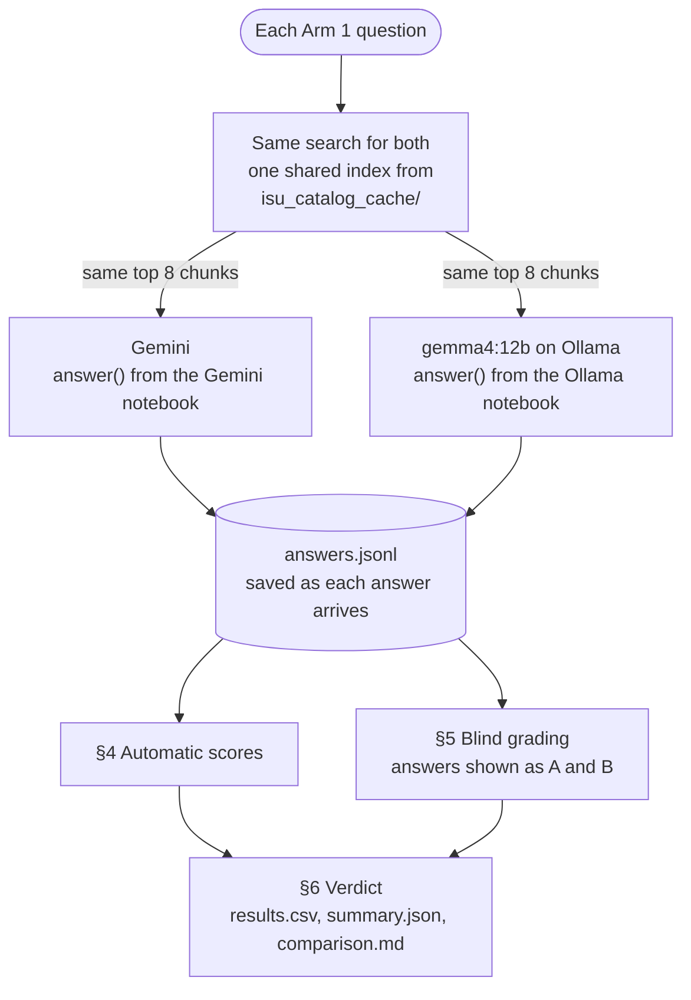

# ReggieBot: Gemini vs Ollama

`ISU-CampusAssistant-Compare.ipynb` asks two answer engines for the ISU Campus Assistant the same questions,
then scores them side by side:

- **Google Gemini**, from `ISU-CampusAssistant-RAG-Demo.ipynb`
- **`gemma4:12b` on Ollama**, a free model on your own computer, from `ISU-CampusAssistant-RAG-Ollama.ipynb`

It answers one question: is the free local model as good as Gemini *for this assistant*?

**Only the model changes.** Both models get:

- the same 50 Arm 1 questions
- the same saved catalog and website data
- the same retrieved chunks
- the same instructions (`SYSTEM_PROMPT`)
- the same temperature (0.2) and answer length (up to 1,200 tokens)

The code is not copied. The notebook loads it straight out of the other two notebooks each time it runs, so it
always compares them exactly as they are now.

## How it works



| Section | What happens |
|---|---|
| **1 · Settings** | How many questions to ask, and how long to pause between Gemini calls |
| **2 · Load** | Builds the search index once from the saved data and sets up both models. Nothing crawls and no chat app starts. |
| **3 · Ask** | Both models answer every question. Each answer is saved as it arrives, so a re-run asks only what is missing. |
| **4 · Automatic scores** | Answered, cites the right source, links websites, declines trap questions, speed |
| **5 · Blind grading** | You grade answers labelled **A** and **B** without knowing which model wrote which |
| **6 · Verdict** | Which one is better, with the numbers behind it |

## Setup and run

1. **Put all three notebooks in one folder:**
   - `ISU-CampusAssistant-Compare.ipynb` (this one)
   - `ISU-CampusAssistant-RAG-Demo.ipynb` (Gemini)
   - `ISU-CampusAssistant-RAG-Ollama.ipynb` (Ollama)
2. **Install the Python packages.** Use the Ollama repo's `requirements.txt`, plus `google-genai` for Gemini:
   ```bash
   python -m venv .venv
   .venv\Scripts\activate            # Windows
   source .venv/bin/activate         # macOS / Linux
   pip install -r requirements.txt google-genai
   ```
3. **Install Ollama** from [ollama.com/download](https://ollama.com/download), start it, and download the
   model once:
   ```bash
   ollama pull gemma4:12b
   ```
4. **Add your Gemini API key.** Get a key at [aistudio.google.com/apikey](https://aistudio.google.com/apikey).
   Put it in a `.env` file next to the notebooks:
   ```
   GOOGLE_API_KEY=your-key-here
   ```
   Never put the key in a notebook, and never commit `.env`.
5. **Make sure the saved data exists.** The comparison reads `isu_catalog_cache/` and never crawls. Running the
   Ollama notebook once creates it, because its first Run All crawls on its own.
6. **Shut down the other two notebooks' kernels.** All three share `isu_catalog_cache/` and its Chroma
   database, and two open kernels can cause `database is locked`.
7. **Do a quick trial first.** Set `QUESTION_LIMIT = 5` in §1 and choose **Run All**. §2 should print
   `Gemini: ready` and `Ollama: ready`.
8. **Run the full comparison.** Set `QUESTION_LIMIT = None` and Run All again. The 5 answers from the trial are
   kept, so only the rest are asked. A full run takes about 10 minutes, mostly the pauses between Gemini calls.
9. **Grade the answers** in the §5 form and press **Save grades**. Then run the §6 cell again for the verdict.

## Settings

| Setting | Default | What it does |
|---|---|---|
| `QUESTION_LIMIT` (§1) | `None` | `None` asks all 50 Arm 1 questions; a number asks only the first N. |
| `GEMINI_PAUSE` (§1) | `6` | Seconds between Gemini calls, to stay inside the free tier's per-minute limit. |
| `SKIP_PROBES` (§1) | `True` | Skips Gemini's startup test calls, which saves 3 requests of quota per run. |
| `BLIND_SEED` (§1) | `7` | Decides which model is shown as "A" on each question while you grade. |
| `RUN_COMPARE` (§3) | `True` | Untick to skip asking. |
| `START_OVER` (§3) | `False` | Sets the saved answers aside (renamed, not deleted) and asks everything fresh. |

## What it measures

**Automatic checks (§4).** These are the same checks as Arm 1, run on both models:

| Measure | What it checks |
|---|---|
| Answered | The model wrote an answer instead of a fallback (quota, busy, Ollama not running) |
| Cites the right source | The answer names the expected course code, or links the expected website |
| Website answers with a link | Billing, housing and dining answers include a source link |
| Trap questions declined | For the questions with no answer in the data, the reply says so instead of inventing one |
| Seconds per answer | Median time for one answer, retries included, pauses between questions not |
| Words per answer | Average answer length |

§4 also breaks "cites the right source" down by category, and prints how many questions gave both models
exactly the same retrieved chunks. It should be all of them.

These checks are text matches. They catch a missing source but not a wrong fact; the blind grading covers that.

**Blind grading (§5).** This is where correctness is decided:

- Each question shows two answers, **A** and **B**. Which model wrote which is random per question and stays
  hidden.
- Bold and heading marks are removed, because the two models format differently and that would give them away.
- Grade each answer *correct*, *partial* or *wrong*, then press **Save grades**.
- You can grade over several sittings. Saved grades come back, and the A/B order never reshuffles.
- Only questions that both models answered are shown, so every comparison is like for like.
- On a trap question, *correct* means it declined, or pointed to the right page, without inventing anything.
- If the form cannot load (no `ipywidgets`), grade in a spreadsheet instead: save it as `grades.csv` with the
  columns `id`, `grade_gemini` and `grade_ollama`.
- `grades.csv` names the models, so open it only after you finish grading.

**The verdict (§6).** Each grade scores *correct* = 1, *partial* = ½ and *wrong* = 0:

- **Graded score:** each model's average over the questions graded for both.
- **Head to head:** on how many questions each model got the better grade, plus the ties.
- Scores less than 5 points apart are called "about even".
- With fewer than 20 questions graded, the verdict is labelled a first look.
- With no grades at all, the verdict is labelled provisional and uses only the automatic checks.
- It also reports speed, reliability (the share answered) and cost.

## How it stays fair

| Held fixed | How |
|---|---|
| Questions | Both models answer `ARM1_QUESTIONS`. |
| Data | `APP.load()` reads the saved data once; nothing re-crawls. |
| Retrieved chunks | Both models search one shared index. Every answer records the ids of the chunks it saw. |
| Instructions | Both notebooks use the same `SYSTEM_PROMPT`. |
| Generation settings | Temperature 0.2 and up to 1,200 output tokens for both. |
| Grading | Blind: random A/B order per question, with formatting marks removed. |

Each model keeps its own app's retries and fallbacks, so each is tested the way a student would use it.

## If Gemini's quota runs out

A full run uses about 50 Gemini requests.

- If a model fails 3 times in a row (for example, Gemini's quota is used up or Ollama stops), it sits out the
  rest of the run and the other model carries on.
- A model that is not ready when §2 runs is skipped from the start.
- Run §3 again later. It skips every question a model has already answered and asks only the missing ones.

## Files it writes

All of these go in `isu_catalog_cache/experiments/compare/`.

| File | What is in it |
|---|---|
| `answers.jsonl` | One line per model per question: status, seconds, retries, the retrieved chunk ids, the automatic checks and the full answer. A re-run adds lines; the latest one wins. |
| `answers_<date>_<time>.jsonl` | Earlier answers, set aside by `START_OVER` |
| `grades.csv` | Your blind grades (`grade_gemini`, `grade_ollama`) |
| `results.csv` | One row per question, with both models' answers and scores side by side |
| `summary.json` | Every automatic and graded number |
| `comparison.md` | The write-up of the run: verdict, automatic-check table and grading tables |

## Troubleshooting

| What you see | What to do |
|---|---|
| `... not found - keep this notebook in the same folder as the other two.` | Move the three notebooks into one folder. |
| `expected 1 code cell starting with ...` | One of the other notebooks was restructured. The message names the cell it could not find. |
| `No saved data in ...` | Run the Ollama notebook once to crawl and save the data. |
| `Gemini: NOT READY` | Put `GOOGLE_API_KEY` in `.env`, then run §2 again. |
| `Ollama: NOT READY` | Start Ollama, or run `ollama pull gemma4:12b`, then run §2 again. |
| `... answer(s) still missing` | Run §3 again later; it asks only the missing ones. |
| Same retrieved chunks on fewer than all questions | The data changed between runs (a re-crawl). Tick `START_OVER` and ask again. |
| `database is locked` | Another notebook's kernel has the cache open. Shut it down. |

## Results

Fill this in from `comparison.md` after a full run and grading.

| Measure | Gemini | Ollama |
|---|---|---|
| Model | | `gemma4:12b` |
| Answered (of 50) | | |
| Cites the right source | | |
| Website answers with a link | | |
| Trap questions declined (of 6) | | |
| Seconds per answer (median) | | |
| Graded score | | |
| Head to head (wins / ties) | | |
| Cost | Free tier, with per-minute and daily limits | Free, on this computer, no limit |

## Limits

- **Small and graded by one person.** 50 questions is a first comparison, not a benchmark.
- **The blinding is partial.** Answer length and style can still hint at which model wrote what.
- **Speed depends on the hardware.** Ollama's speed depends on your GPU; Gemini's depends on the network and on
  Google's load.
- **The recorded Gemini model can be wrong after a fallback.** If a busy error made Gemini fall back to another
  model, the record still names the first one.
